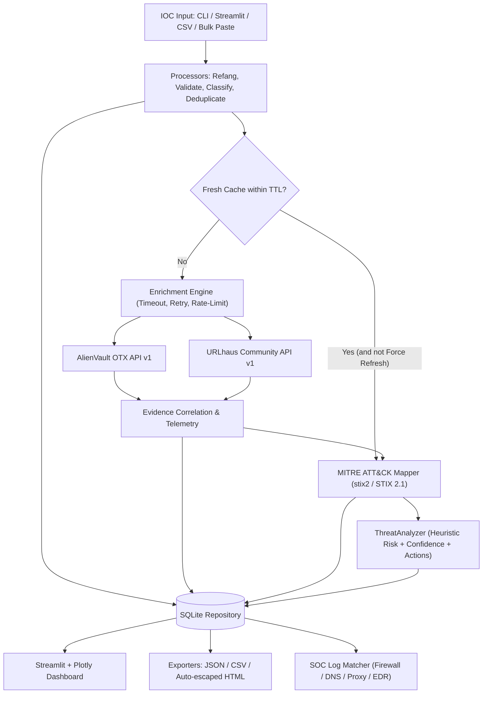

# System Architecture

## 1. High-Level Overview

The **Automated Threat Intelligence & IOC Enrichment Platform** automates the repetitive SOC analyst triage workflow: ingesting indicators of compromise (IPv4, IPv6, Domain, URL, MD5, SHA1, SHA256), normalizing and deduplicating them, enriching them against external Threat Intelligence APIs, mapping evidence to MITRE ATT&CK (STIX 2.1), calculating explainable Heuristic Risk and Confidence scores, correlating IOCs against SOC logs, and presenting results via CLI, Streamlit Dashboard, and exportable reports.

## 2. Core Design Principles

1. **Single Core Pipeline (`app/pipeline.py`):** Both the CLI (`app/main.py`) and the Streamlit Dashboard (`app/dashboard/dashboard.py`) invoke `ThreatIntelPipeline`, eliminating duplicated business logic.
2. **Real Threat Intelligence & Graceful Degradation:** Connectors target real AlienVault OTX (`X-OTX-API-KEY`) and URLhaus (`Auth-Key`) REST endpoints. When API keys are absent or a source fails/times out, the platform records explicit status telemetry (`skipped_no_key`, `timeout`, `error`), continues enriching remaining sources, and lowers the Confidence Score rather than crashing or faking evidence.
3. **Strict Timestamp Separation:** External TI observation timestamps (`source_first_seen`, `source_last_seen` persisted on `indicators.first_seen`/`last_seen`) are strictly separated from local query timestamps (`enrichment_results.retrieved_at` and `threat_reports.generated_at`).
4. **Defensive Security Handling:**
   - API keys are loaded exclusively from environment variables / `.env` as Pydantic `SecretStr` values and are never logged or serialized into reports.
   - Analysts can submit defanged IOCs (`hxxps://`, `[.]`) and export reports defanged by default.
   - HTML report rendering uses Jinja2 strict auto-escaping (`select_autoescape`) to prevent XSS payloads embedded in external TI tags or URLs.

## 3. Module Breakdown

| Module | Location | Responsibility |
| :--- | :--- | :--- |
| Config & Schemas | `app/config.py`, `app/schemas.py` | Validated `.env` settings (`pydantic-settings`) and shared Pydantic v2 data contracts. |
| Module 1: Collection | `app/collectors/csv_loader.py`, `otx.py`, `urlhaus.py` | Load CSV/text batches; query OTX & URLhaus APIs; collect OTX subscribed pulses & recent URLhaus feeds. |
| Module 2: Normalization | `app/processors/validator.py`, `normalizer.py`, `deduplicator.py` | Refang/defang, strict IOC classification, non-routable/TEST-NET IP detection, batch & DB deduplication. |
| Module 3: Enrichment | `app/collectors/base.py`, `app/enrichment/enrichment_engine.py` | `httpx` retry/backoff/timeout client, TTL SQLite caching, multi-source correlation, latency telemetry. |
| Module 4: Analysis | `app/analysis/risk_scoring.py` | Heuristic Risk Score (0–100), decoupled Confidence Score (0–100), analyst summary, SOC actions. |
| Module 5: MITRE ATT&CK | `app/enrichment/mitre_mapper.py`, `data/mitre/` | `stix2.MemoryStore` parsing of STIX 2.1 Enterprise ATT&CK bundle (local subset + sync full bundle). |
| Module 6: Reporting & UI | `app/reporting/exporter.py`, `app/dashboard/dashboard.py`, `app/main.py` | JSON/CSV/HTML exporters, CLI commands, and 4-tab Streamlit + Plotly workbench. |
| Bonus: SOC Log Matching | `app/matching/log_matcher.py` | O(1) correlation of CSV/JSONL/plain-text Firewall, DNS, Proxy, and EDR logs against stored IOCs. |

## 4. Database Schema (SQLite)

The repository (`app/database/models.py`, `app/database/repository.py`) runs SQLite in WAL mode with `PRAGMA foreign_keys = ON` and 7 tables:

- `indicators`: Deduplicated indicators enforced by `UNIQUE(normalized_value, type)`, storing `is_reserved_ip`, `ip_scope_note`, and source `first_seen`/`last_seen`.
- `sources`: Seeded Threat Intelligence sources and reliability weights.
- `enrichment_results`: Per-source evidence snapshots, `status`, `latency_ms`, `source_first_seen`/`source_last_seen`, and `retrieved_at`.
- `threat_reports`: Versioned analyst evaluations with JSON `score_breakdown`, `risk_score`, `confidence_score`, `summary`, and `recommended_actions`.
- `attack_techniques`: Cached MITRE ATT&CK technique metadata (`technique_id`, `name`, `tactic`, `description`, `url`).
- `indicator_attack_techniques`: Many-to-many evidence links (`indicator_id`, `technique_id`, `source_name`, `evidence`, `confidence`).
- `log_matches`: Persisted SOC log correlation alerts referencing `indicators(id)`.

## 5. Future Scalability Path

Because all SQL queries are isolated behind `ThreatIntelRepository` and all business workflows live in `ThreatIntelPipeline`, the platform can later transition to:
- **FastAPI** REST backend wrapping `ThreatIntelPipeline`
- **PostgreSQL** replacing SQLite in `repository.py`
- **Async concurrent enrichment** leveraging `httpx.AsyncClient`

